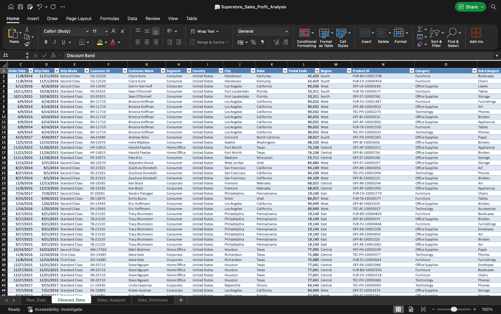
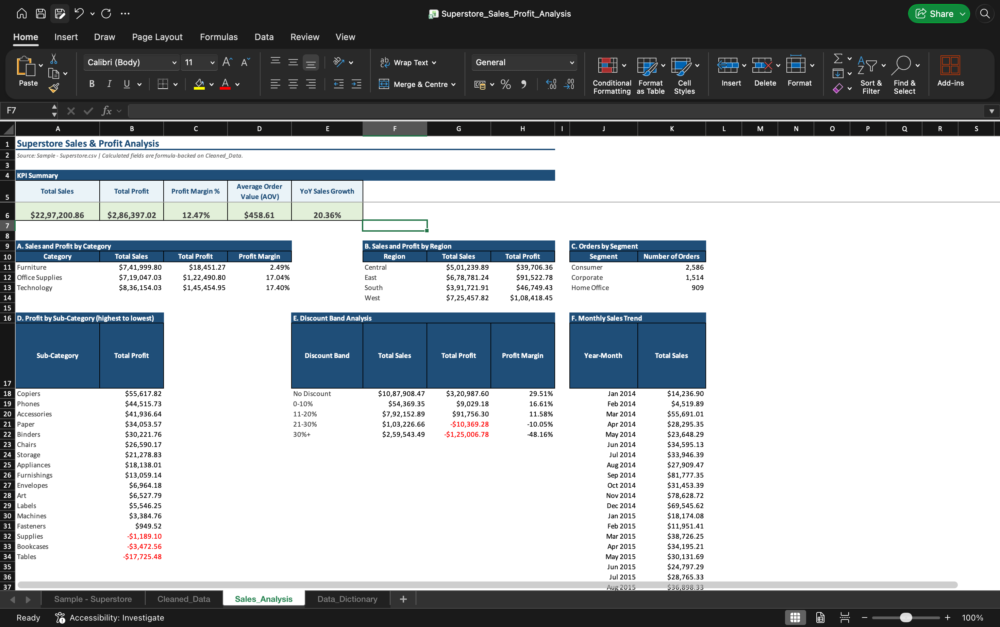
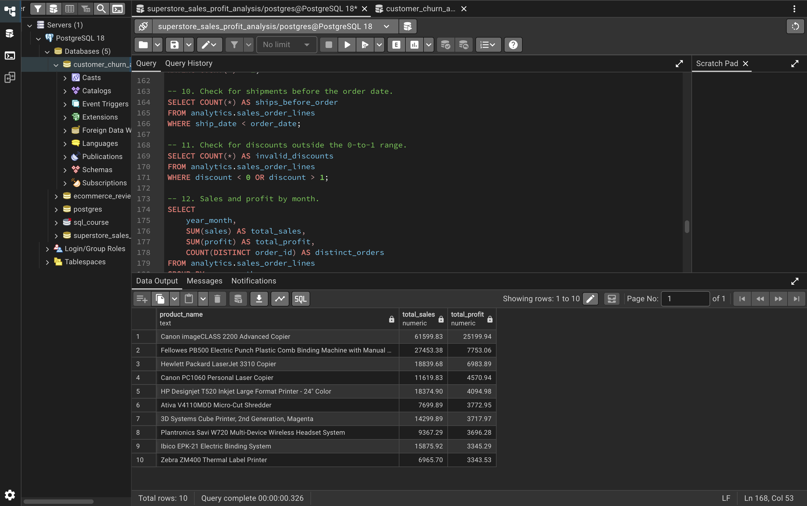
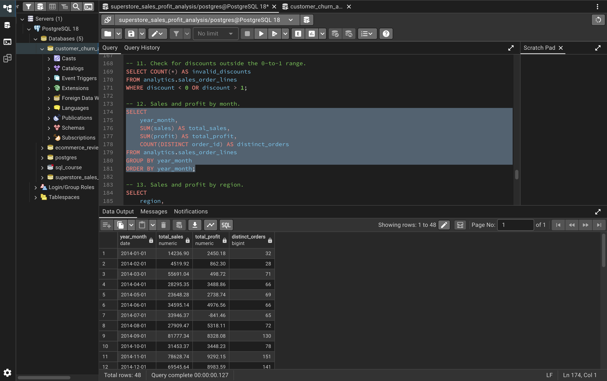
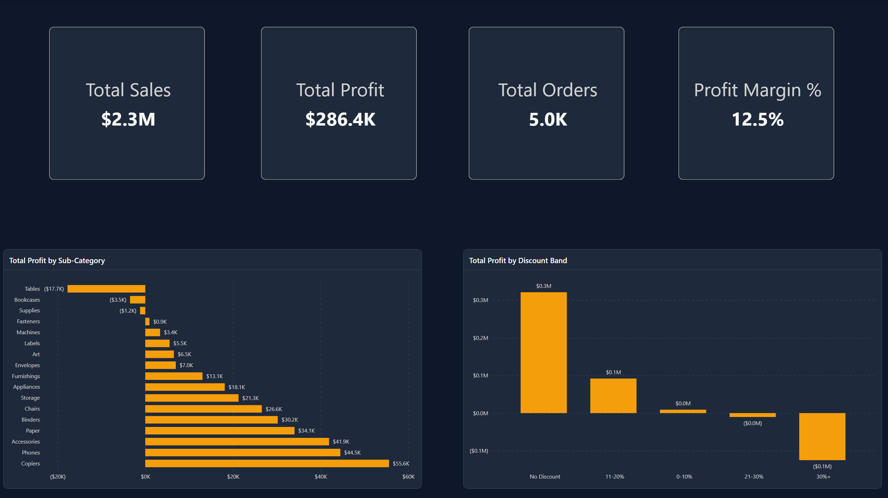

# Superstore Sales & Profit Analysis

**Where the money is made, and where it quietly leaks.**

I wanted a project where I could follow a business dataset the way it would move through a real team: clean it in Excel, check and query it in PostgreSQL, then present the answers in a Power BI dashboard.

For this project, I used the well-known *Sample - Superstore* dataset, which contains order-level sales, profit, discount, customer and product information for a fictional US retail business between 2014 and 2017.

The main goal was to work out which parts of the business actually make money, which parts lose it, and whether discounting has anything to do with the difference.

This is an independent portfolio project using a publicly available dataset. It is not based on any company's internal data.

## What I wanted to find out

While exploring the dataset, I focused on a few questions:

- Which categories, regions and customer segments bring in the most sales and profit?
- Which sub-categories are losing money?
- How do discounts affect profit?
- How have sales and profit changed from 2014 to 2017?
- Which individual products earn the most profit?

## Tools I used

- **Microsoft Excel** – Cleaning the dataset, adding calculated columns, building a formula-backed KPI summary and writing a data dictionary.
- **PostgreSQL** – Loading the data into a staging table, converting it into proper data types, running validation checks and answering the questions with SQL.
- **Power BI** – Building a dashboard to present the results visually.

## Working with the data

The dataset contains **9,994 order lines** placed between 3 January 2014 and 30 December 2017, covering 5,009 orders, 793 customers and 1,862 products.

I checked the data for duplicate rows and missing values and found none, so no records had to be removed (9,994 rows in, 9,994 rows out).

I then added five columns in Excel:

- `Profit Margin` – Profit divided by Sales (returns 0 when Sales is 0).
- `Order Year` – The calendar year of the order.
- `Order Month` – The month name of the order.
- `Year-Month` – The first day of the order month, so months sort in the right order.
- `Discount Band` – Groups discounts into No Discount, 0-10%, 11-20%, 21-30% and 30%+.

I kept the original data on its own sheet, added a data dictionary that explains every column, and exported the cleaned version for the SQL and Power BI work.

### The headline numbers

| Metric | Value |
|---|---:|
| Total Sales | $2,297,200.86 |
| Total Profit | $286,397.02 |
| Profit Margin | 12.47% |
| Total Orders | 5,009 |
| Average Order Value | $458.61 |
| Sales Growth, 2017 vs 2016 | 20.36% |

### A look at the data preparation



### The KPI summary and analysis tables in Excel



## Exploring the data with SQL

I loaded the CSV into a staging table in PostgreSQL first, then copied it into a clean analytics table with proper data types (dates as dates, money as numbers). The calculated fields were rebuilt in SQL so the results could be compared with Excel.

Before analysing anything, I ran a few checks:

- Are there any duplicate row IDs?
- Did any order ship before it was placed?
- Are all discounts between 0 and 1?

After that, I worked through the questions using SQL. Here are some of the findings.

### 1. Sales and profit by category

| Category | Sales | Profit | Profit Margin |
|---|---:|---:|---:|
| Technology | $836,154.03 | $145,454.95 | 17.40% |
| Office Supplies | $719,047.03 | $122,490.80 | 17.04% |
| Furniture | $741,999.80 | $18,451.27 | 2.49% |

Furniture sells almost as much as Office Supplies, but earns only about 15% of its profit.

### 2. Which sub-categories make and lose money

| Sub-Category | Profit |
|---|---:|
| Copiers | $55,617.82 |
| Phones | $44,515.73 |
| Accessories | $41,936.64 |
| Supplies | -$1,189.10 |
| Bookcases | -$3,472.56 |
| Tables | -$17,725.48 |

Three sub-categories lose money. Tables are the worst: they carry an average discount of 26.1%, and 38.2% of Tables order lines were discounted by more than 30%. Copiers, the best performer, average a 16.2% discount.

### 3. Do discounts hurt profit?

This was the most interesting result in the whole project.

| Discount Band | Sales | Profit | Profit Margin |
|---|---:|---:|---:|
| No Discount | $1,087,908.47 | $320,987.60 | 29.51% |
| 0-10% | $54,369.35 | $9,029.18 | 16.61% |
| 11-20% | $792,152.89 | $91,756.30 | 11.58% |
| 21-30% | $103,226.66 | -$10,369.28 | -10.05% |
| 30%+ | $259,543.49 | -$125,006.78 | -48.16% |

Order lines discounted by more than 30% are only 11.7% of all rows (1,166 of 9,994), but together they lost **$125,006.78**, which is equal to about 44% of the total profit the business earned.

### 4. Regions and customer segments

| Region | Sales | Profit | Profit Margin | Average Discount |
|---|---:|---:|---:|---:|
| West | $725,457.82 | $108,418.45 | 14.95% | 10.9% |
| East | $678,781.24 | $91,522.78 | 13.48% | 14.5% |
| South | $391,721.91 | $46,749.43 | 11.93% | 14.7% |
| Central | $501,239.89 | $39,706.36 | 7.92% | 24.0% |

Central is the third-largest region by sales, but it has the lowest margin and the highest average discount.

| Segment | Orders | Sales | Profit |
|---|---:|---:|---:|
| Consumer | 2,586 | $1,161,401.34 | $134,119.21 |
| Corporate | 1,514 | $706,146.37 | $91,979.13 |
| Home Office | 909 | $429,653.15 | $60,298.68 |

### 5. How the business changed over time

| Year | Sales | Profit | Profit Margin |
|---|---:|---:|---:|
| 2014 | $484.2K | $49.5K | 10.2% |
| 2015 | $470.5K | $61.6K | 13.1% |
| 2016 | $609.2K | $81.8K | 13.4% |
| 2017 | $733.2K | $93.4K | 12.7% |

Sales dipped slightly in 2015 and then grew each year after that. In 2017 sales grew by 20.4%, but the profit margin slipped a little compared with 2016.

### 6. The most profitable products

The product with the highest profit was the **Canon imageCLASS 2200 Advanced Copier**, with about $25.2K of profit from $61.6K of sales. The Fellowes PB500 Electric Punch Plastic Comb Binding Machine and the Hewlett Packard LaserJet 3310 Copier came second and third, with about $7.8K and $7.0K of profit.

### SQL Work Previews






## Building the Power BI dashboard

After the SQL analysis, I moved to Power BI to bring the main findings together in one place.

The dashboard includes four key metrics:

- **Total Sales:** $2.30M
- **Total Profit:** $286.40K
- **Profit Margin:** 12.47%
- **Total Orders:** 5,009

<!-- Edit this list so it matches the visuals on your final dashboard -->
It also includes these visualizations:

- Profit by sub-category
- Profit by discount band

The numbers on the dashboard match the Excel and SQL results.

The four metrics are built with simple DAX measures:

```
Total Sales = SUM(CleanedDataTable[Sales])
Total Profit = SUM(CleanedDataTable[Profit])
Profit Margin % = DIVIDE([Total Profit], [Total Sales])
Total Orders = DISTINCTCOUNT(CleanedDataTable[Order ID])
```

### Dashboard Preview



## What I would suggest to the business

Based on what I found, these are the things I would look at first:

- **Review discounts above 30%.** That band lost nearly half of its sales value in profit (a -48.16% margin), so a cap or an approval step might be worth testing.
- **Look at the pricing of Tables, Bookcases and Supplies.** They are the only sub-categories with negative profit.
- **Look into the Central region.** It has the lowest margin and the heaviest discounting.
- **Lean into Technology and Office Supplies**, which earn the most profit for the sales they bring in.

## A few things worth keeping in mind

There are some limitations to this analysis:

- The discount bands are thresholds I chose for this project, not official standards.
- Discount depth and losses move together in this data, but that doesn't prove the discounts caused the losses. Some discounts may have been applied to products that were already unprofitable.
- The 21-30% band has only 227 order lines, so I wouldn't read too much into it on its own.
- Superstore is a sample dataset for a fictional business, so the findings show the method rather than the performance of a real company.
- The data ends in 2017, and profit is used as it appears in the source, with no cost breakdown.

## Project structure

```
Project_02/
├── Data/
│   ├── Raw/        Sample - Superstore.csv
│   └── Clean/      Superstore_Sales_Profit_Analysis_Cleaned.csv
├── Excel/          Superstore_Sales_Profit_Analysis.xlsx
├── SQL/            Superstore_Sales_Profit_Analysis.sql
├── Power_BI/       Superstore_Sales_Profit_Dashboard.pbix
└── Images/         Screenshots used in this README
```

## What I learned

This project gave me practical experience working through a complete data analysis workflow: cleaning a dataset in Excel, validating and querying it in PostgreSQL, and turning the findings into a Power BI dashboard.

The part I valued most was checking that the same headline numbers came out of Excel, SQL and Power BI before I trusted any of them. It also taught me to be careful about what the data can actually tell us. A pattern like "heavy discounts, heavy losses" is a good lead, but it is not proof of why it happens.

**Thanks for taking a look at my project!**

**Nishant Sahay** · [LinkedIn](https://www.linkedin.com/in/nishant-sahay-0a6229215) · [GitHub](https://github.com/nsahay007) · nishantsahay480@gmail.com
